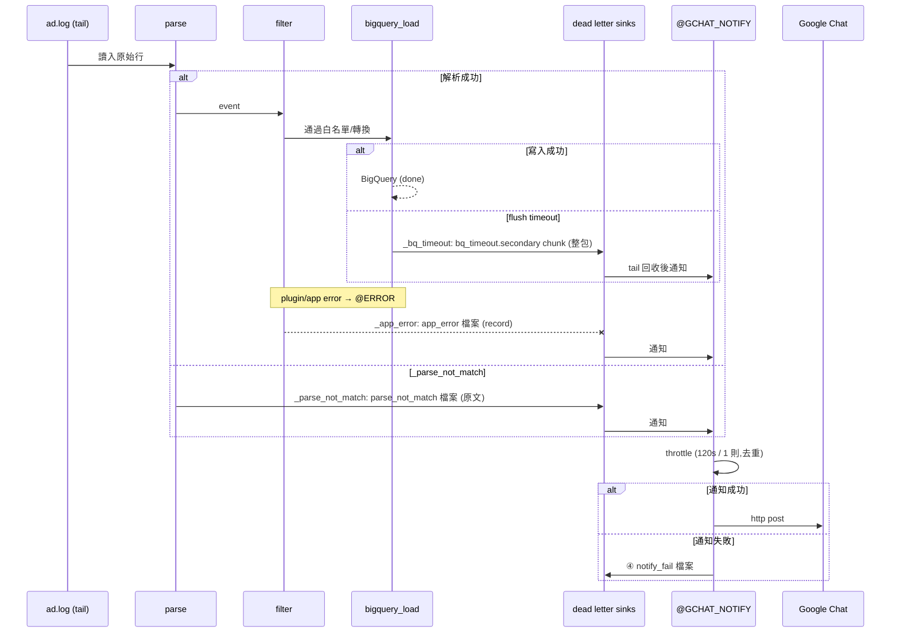

# td-agent 設定解析

本文件說明 `td-agent/` 目錄下所有 Fluentd 設定檔的用途、想捕捉的資料品質問題,以及「通知」與「dead letter」兩種意圖分別用什麼機制達成。

## 整體架構

`td-agent.conf` 是入口,依序 `@include` 五個模組。資料流是:**tail 日誌 → 解析分流 → 過濾/轉換 → 寫入 BigQuery**,其餘各檔負責處理不同的失敗路徑,最後統一匯流到 Google Chat 通知。

檔名採「**數字前綴(對應 `td-agent.conf` 的 include 順序)+ 角色語意**」命名:`10 / 20 / 30` 分段對應「主流程 / dead letter / 通知」三大職責群,一眼看出資料流順序與職責。

| 檔案 | 職責 |
|------|------|
| `10_pipeline_main.conf` | 主流程:讀 `ad.log`、解析、過濾、寫 BQ |
| `11_bq_output.conf` | BigQuery output 連線設定(被 include) |
| `12_bq_buffer.conf` | BigQuery output 的 buffer 設定(被 include) |
| `20_deadletter_parse_not_match.conf` | 資料品質問題①:解析失敗 (`parse_not_match`) |
| `21_deadletter_app_error.conf` | 資料品質問題②:plugin / app 層錯誤 (`@ERROR`) |
| `22_deadletter_bq_timeout.conf` | 資料品質問題③:BQ 寫入 timeout 的 dead letter 回收與通知 |
| `30_notify_gchat.conf` | 共用出口:所有通知匯流到 Google Chat |
| `pipeline_diagram.md` | 整體流程圖 |

---

## 主流程 (`10_pipeline_main.conf`)

1. **Source**:`tail /var/log/go/ad.log`,`read_from_head true`(從頭讀,確保不漏),用 `multi_format` 解析。
2. **關鍵設計 — 解析永不丟失**:兩個 pattern 依序嘗試
   - `json`:成功 → `_parsed_format=json`
   - `none`(fallback):JSON parse 失敗時,**不丟棄**,而是把整行原文塞進 `raw_row`,標記 `_parsed_format=parse_not_match`
3. **rewrite_tag_filter** 依 `_parsed_format` 分流成 `ad_fluentd.json` / `ad_fluentd.parse_not_match`。
4. **三層過濾**(資料品質的核心 gate):
   - 只允許 `_BC_ == "SVCX.ADLOG"`(Bounded Context 白名單)
   - 排除 `_subject_ == "ad.AD_RT"`(符合格式但不進 BQ 的欄位)
   - `whitelist_keys` 只留 `datetime,_BC_,_bigquery_,payload`
5. **動態 retag + 攤平**:依 `_bigquery_` 欄位決定目標 table,retag 成 `SVCX.ADLOG.${_bigquery_}`,並把 `payload` 攤平到頂層。
6. **bigquery_load** 寫入,`fetch_schema=true`(自動抓 schema)、`ignore_unknown_values=true`(容忍多餘欄位)。

### BigQuery 連線 (`11_bq_output.conf`)

- `auth_method json_key`,使用 `xxxx-data` 專案的 service account 金鑰
- `dataset SVCX`、`table ${_bigquery_}`(動態帶入)、`location asia-east1`

### BigQuery buffer (`12_bq_buffer.conf`)

- 檔案型 buffer,`chunk_limit_size 128MB` / `total_limit_size 1GB`
- `overflow_action throw_exception`(滿了直接拋錯,交給錯誤路徑處理)
- `flush_interval 60s`,`retry_timeout 24h`,`retry_type exponential_backoff`

---

## 想捕捉的三種資料品質問題

| 類型 | 問題說明 | 觸發點 | 處理檔案 |
|------|---------|--------|--------|
| `_parse_not_match` | **格式解析失敗** — 這行根本不是合法 JSON | source `multi_format` 落到 `format none` | `20_deadletter_parse_not_match.conf` |
| `_app_error` | **plugin / 應用層錯誤** — 任一 plugin(filter **或** `bigquery_load`)拋例外,如 schema 不符、非重試型 insert 錯誤、runtime error 等 | Fluentd `@ERROR` label | `21_deadletter_app_error.conf` |
| `_bq_timeout` | **BQ 寫入 timeout** — buffer flush 超時、`retry_timeout` 耗盡 | `bigquery_load` 的 `<secondary>` | `22_deadletter_bq_timeout.conf` |

### 為什麼要分三個觸發點,不能「出錯後統一捕捉一種」?

關鍵原因:**這三種問題在資料管線裡發生的「時間點」與「Fluentd 提供的攔截機制」根本不同,不存在一個能同時攔到三者的統一入口。**

它們沿著管線由前到後,是三個先後、互斥的階段:

```
happy path:  讀入(parse) ─────> 過濾/轉換 ─────> 寫入 BQ(output) ─────> BigQuery
                  │                 └───── _app_error ─────┘    │
                  │              (任一 plugin 拋例外 → @ERROR,   │
             _parse_not_match         含 BQ 寫入時 schema 不符 /       └── _bq_timeout
                                  非重試型 insert 錯誤)          (flush 逾時 / retry 耗盡 → <secondary>)
```

注意:`_app_error` **不是只發生在轉換階段** —— 只要任一 plugin(filter 或 `bigquery_load`)拋出例外都會進 `@ERROR`,所以「寫入 BQ 失敗」也可能是 `_app_error`。`_app_error` 與 `_bq_timeout` 都可能在寫 BQ 這一步發生,差別在於:**拋例外(如 schema 錯)→ `_app_error`**;**送不出去、一直逾時/重試耗盡(資料本身沒問題)→ `_bq_timeout`**。

- **`_parse_not_match` 發生在「資料還沒變成 event」的時候。** JSON 解析失敗時,record 根本組不出來,`@ERROR` 這種「event 層級」的機制看不到它。只能在 source 的 `multi_format` 用 `format none` fallback 把整行原文接住。→ 這是 **parse 階段** 的攔截。
- **`_app_error` 發生在「event 已成形、但某個 plugin 拋出例外」的時候。** 這是 Fluentd 內建的 `@ERROR` label 專門負責的範圍,**橫跨 filter 與 output 兩個階段** —— 不只轉換階段,連 `bigquery_load` 在寫入時因 schema 不符、非重試型 insert 錯誤而拋例外,也會進 `@ERROR`。→ 這是 **plugin 執行階段** 的攔截。
- **`_bq_timeout` 發生在「event 正確、BQ 也沒拒絕,只是 flush 一直逾時 / 重試耗盡」的時候。** 它與 `_app_error` **都可能在寫 BQ 這一步發生**,關鍵差別在:拋例外 → `_app_error`;資料本身沒問題、只是送不出去 → `_bq_timeout`。後者不是「錯誤事件」,而是「送不出去的 chunk」,`@ERROR` 攔不到,只能靠 output plugin 原生的 `<secondary>` 把整個 buffer chunk 導出。→ 這是 **output/buffer 階段** 的攔截。

換句話說,「捕捉一種就好」在技術上做不到 —— 沒有任何單一機制能同時涵蓋「還沒成 event」「event 處理失敗」「event 送不出去」這三種狀態。三個觸發點是被 Fluentd 的架構逼出來的必要拆分,而不是設計上的重複。

而且分開還有額外好處:**能保留不同的診斷脈絡**。`_parse_not_match` 需要的是「原始那行文字」(才知道哪裡格式壞了);`_app_error` 需要的是「完整 record + tag」(才知道哪個 plugin/欄位出錯);`_bq_timeout` 需要的是「整個 chunk」(才能原封不動重送 BQ)。混成一種反而會丟失各自最關鍵的還原資訊。

### 為什麼要分三個 sink 存備用資料?

因為 **每種問題的「後續處理方式」不同,分開存才能各自重跑,不會互相污染**:

| 類型 | Sink 路徑 | 存什麼 | 為什麼要獨立 |
|------|-----------|--------|-------------|
| `_parse_not_match` | `deadletter/parse_not_match.format-none/parse_not_match.${date}.log` | 原始整行文字 (`raw_row`) | 要修的是「上游輸出格式」;重跑前得先人工判讀原文,不能直接灌 BQ |
| `_app_error` | `deadletter/app_error.error-label/app_error.${date}.log` | 完整 record JSON | 要修的是「schema / 欄位對應」;重跑對象是結構化 record |
| `_bq_timeout` | `deadletter/bq_timeout.secondary/bq_timeout.${chunk_id}` | 整個 buffer chunk | 資料本身正確,**修好連線後可直接重送**,格式與其他兩種完全不同 |

所有 sink 統一收在 `/var/log/go/deadletter/` 根目錄下,目錄名採 `<錯誤類型>.<產生機制>` 格式(對齊 `_parse_not_match` / `_app_error` / `_bq_timeout`,並標出是哪個 Fluentd 機制接住的),檔名帶分檔鍵(按天 `date` 或按 chunk `chunk_id`)方便重跑定位。通知本身失敗的 sink 同樣收在此:`deadletter/notify_fail.secondary/notify_fail.${chunk_id}`(`@GCHAT_NOTIFY` output 的 `<secondary>`)。

---

如果三者混在同一個檔案:

1. **重跑邏輯會打架** —— `_bq_timeout` 可以無腦重送,但 `_parse_not_match` / `_app_error` 直接重送只會再度失敗;混在一起就無法用單一腳本回灌。
2. **格式不相容** —— `_parse_not_match` 是純文字、`_app_error` 是 record、`_bq_timeout` 是 chunk 二進位/序列化格式,塞同一個 sink 無法用同一 parser 讀回。
3. **依日期 vs 依 chunk 的分檔粒度不同** —— `_parse_not_match` / `_app_error` 用 `error_date` 按天歸檔方便稽核;`_bq_timeout` 用 `chunk_id` 對應 buffer 單位方便重送。
4. **責任歸屬清楚** —— 看目錄名就知道是「上游格式問題 / 本服務 schema 問題 / BQ 基礎設施問題」,分別找不同的人處理。

一句話總結:**觸發點分三個是被管線階段與 Fluentd 機制決定的(不得不分);sink 分三個是被「重跑方式不同」決定的(刻意要分)。** 兩者都不是重複,而是讓每種失敗都能用最適合的方式被接住與復原。

---

## 通知 vs Dead Letter 的機制設計

這套設定的精髓是 **「本地落地(dead letter)」與「即時通知」雙軌並行**,幾乎每條失敗路徑都同時做這兩件事。

### 機制 A — Dead Letter(本地檔案落地,不丟資料)

用 `@type file` 或 `@type secondary_file` 把失敗記錄寫到磁碟,依日期 / chunk 分檔:

- **`_parse_not_match`** (`20_deadletter_parse_not_match.conf`):`copy` 分兩路,一路寫檔 `deadletter/parse_not_match.format-none/parse_not_match.${error_date}.log`(用 `single_value` 格式只存 `raw_row` 原文,方便日後重跑)。
- **`_app_error`** (`21_deadletter_app_error.conf`):`copy` 分兩路,一路寫檔 `deadletter/app_error.error-label/app_error.${error_date}.log`(把整個 record 轉 JSON 存 `raw_row`)。
- **`_bq_timeout`** (`10_pipeline_main.conf` 的 `<secondary>`):走 Fluentd 原生 `<secondary>` 機制 — 主 output 超時後,chunk 直接落地到 `deadletter/bq_timeout.secondary/bq_timeout.${chunk_id}`。註解特別引用官方原則「**打印優先,通知其次**」,所以 secondary 只負責存檔,不做通知。

### 機制 B — 通知(Google Chat)

**`_bq_timeout` 的通知是靠一個獨立回收流程達成的**(最巧妙的一環):`22_deadletter_bq_timeout.conf` 用另一個 `tail` 去讀 secondary 落地的 chunk 檔案(`refresh_interval 60s`),再轉成通知。這樣就把「落地」和「通知」解耦,符合官方建議。

所有通知路徑(`_parse_not_match` / `_app_error` / `_bq_timeout`)最後都 `relabel @GCHAT_NOTIFY`,匯流到 `30_notify_gchat.conf` 的共用出口:

1. **throttle 防洪**:`group_key=notify_group`,同類型錯誤每 120 秒最多 1 則,`group_drop_logs true` 丟棄期間其餘訊息,避免刷爆。
2. **標記 `_gchat_notification=true`**:組出 `gchat_payload`。
3. **http post** 到 webhook(`SVCX_FLUENT_GCHAT_WEBHOOK_URL`),`flush_mode immediate`。
4. **通知本身也有 dead letter**:http 失敗 → `<secondary>` 落地到 `deadletter/notify_fail.secondary/notify_fail.${chunk_id}`。

### 防迴圈設計

`21_deadletter_app_error.conf` 裡有一段 `grep exclude`,把 `_gchat_notification=true` 的事件排除掉。原因:GChat 通知若送失敗,自己也會變成一個 error event 被 `@ERROR` 捕捉,若不排除就會「通知失敗 → 產生錯誤 → 再通知 → 再失敗」無限迴圈。

---

## 已知限制(來自設定檔註解)

`21_deadletter_app_error.conf` 明確指出:Fluentd `@ERROR` 的 event record **不含 plugin 的完整 exception message / backtrace**(附了 `root_agent.rb` 原始碼連結)。所以 GChat 通知只能看到 tag + 原始 record,真正的失敗原因**仍需登入 VM 看 `/var/log/td-agent/td-agent.log`**,且建議 `log_level` 至少設 `warn`(部分 plugin 的重試訊息是 warn 等級)。

---

## 設計意圖小結

整套設定體現三個原則:

1. **絕不丟資料** — 任何階段失敗都有對應的本地 dead letter 檔案,可事後重跑。
2. **落地優先、通知其次** — 尤其 BQ timeout 走「先存檔、再由獨立 tail 回收通知」的解耦模式。
3. **通知要能收斂且不自噬** — throttle 防洪 + `_gchat_notification` 防迴圈 + 通知失敗自己也有 secondary 落地。

---

## 附:重點 data flow(sequence diagram)

完整流程圖見 `td-agent/pipeline_diagram.md`;下圖只保留核心資料流與三條失敗支線。



三大重點:

1. **主線一條**:`ad.log → parse → filter → bigquery_load → BigQuery`。
2. **失敗都先落地(dead letter),再匯流通知**:三種失敗各有專屬 sink(`_parse_not_match`→原文 / `_app_error`→record / `_bq_timeout`→chunk),不丟資料。
3. **通知統一出口 `@GCHAT_NOTIFY`**:先 throttle 防洪去重 → http post;連通知失敗也有 sink④ 落地。